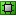
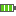

> [!WARNING]
> **This document covers development and contribution aspects**. Visit [cerf.cx](https://cerf.cx)
> for user-oriented documentation. This repository includes emulator frontends, website and other tools.


<div align="center">
  <b>Root repository - UIs and build tools</b><br/> 
  <a href="https://github.com/gweslab/libCerfEngine">libCerfEngine</a> - JIT repository;
    <a href="https://github.com/gweslab/libCerfCore">libCerfCore</a> - Emulator repository;
  <b><a href="https://cerf.cx">cerf.cx</a></b> - read more information about the project<br/>
</div><br/>

<div align="center">
  <a href="https://discord.gg/QREE9Y2v2d"></a> <a href="https://www.patreon.com/dz3n"></a>
</div>

<br/>

> [!WARNING]
> **Beta stage.** It is a hobby project, developed in spare time
> and can't be a called production-grade/exceptionally stable project.
> **Expect bugs, crashes, and breaking changes.** CERF stays beta permanently

> [!WARNING]
> Project is under [CE Runtime Foundation License](LICENSE) since 8.0.4. All the prior code is permanently under MIT. For 8.0.4+ code:
> - If you are using code heavily - write "Based on CE Runtime Foundation - https://cerf.cx" in its UI
> - Non-commercial use only. The goal of the project is historical preservation rather than earning money. If you want to use the project to do business - contact cerf.commercial@yaroslavkibysh.com for enterprise license.
> - Barter and common goals are welcome. If you want to use CERF in commercial for the sake of historical showcase; you contribute to the project or want any other exceptions - I'm open to discussions anytime.
> - The license is experimental, and we might drop it later if circumstances prove it

## Downloads

Visit [the website](https://cerf.cx/download) to learn how to download a stable or an unstable build.

8.1 [](https://github.com/gweslab/cerf/actions/workflows/build.yml)

## [Contribution Guidelines](.github/CONTRIBUTING.md)

Please read [these](.github/CONTRIBUTING.md) if you are planning on contributing.

## Building

CERF builds on Windows, Linux and macOS with the same `build.py` script.

### Windows

Install modern Visual Studio with the C++ desktop development workload.

> [!NOTE]
> **The first build on a new machine takes more than one hour.** vcpkg compiles the dependencies from source, and `build.py` builds Qt into `third_party/qt/`. This occurs one time on each machine. Later builds use the cached trees and are complete in a few minutes. Do not stop the first build.

### Linux

Install the build packages. These are the Ubuntu 26.04 names:

```
sudo apt install git cmake ninja-build g++ pkg-config ccache wine clang patchelf curl zip unzip tar make perl bison flex libgl-dev libasound2-dev libxcb1-dev libxcb-randr0-dev libwayland-dev
```

Clone vcpkg and run `bootstrap-vcpkg.sh` in the clone. Set `VCPKG_ROOT` to the clone. The build downloads Qt into `third_party/qt/` and ships it with CERF.

### macOS

Install the Xcode Command Line Tools (`xcode-select --install`) and [Homebrew](https://brew.sh). Then install the build packages:

```
brew install cmake ninja pkgconf ccache qtbase qtsvg qtdeclarative libslirp libzip nlohmann-json
```

### All hosts

> [!CAUTION]
> Development environment might need additional configuration on your machine that this guide doesn't explain. If you find a bug there, or find a more universal approach - feel free to submit a pull request.

Configure the clone (one time on each machine), then build the entire project with a helper script. On Windows:

```
python tools/dev_setup.py
python build.py
```

On Linux and macOS:

```
python3 tools/dev_setup.py
python3 build.py
```

`tools/dev_setup.py --check` is a dry run. The setup will

- point git at tracked hooks
- report missing prerequisite

The build script will:

- wait for a parallel build (Claude Code-special feature for parallel agents work)
- install a pinned Rust toolchain into `third_party/rust` and build the resvg SVG renderer
- build the emulator itself (and will pick appropriate SDK/toolchain from your installations)
- build all the bundled Windows CE apps (at `ce_apps/`)

### Android

`python build.py --android` builds `build/<Config>/android-arm64/cerf.apk` on a Windows or x86-64 Linux host.

`python build.py --android=amd64` builds `build/<Config>/android-amd64/cerf.apk` for an x86_64 Android emulator. Install these first:

- the Android SDK with `platforms;android-36`, `build-tools;36.0.0` and `ndk;29.0.14206865`, and set `ANDROID_SDK_ROOT` to it
- a JDK 17 or newer, and set `JAVA_HOME` to it
- on Linux, a vcpkg checkout with `bootstrap-vcpkg.sh` run in it, and set `VCPKG_ROOT` to it

The build downloads Qt 6.12 for Android and for the host into `third_party/qt/`.

To sign the package, set `QT_ANDROID_KEYSTORE_PATH`, `QT_ANDROID_KEYSTORE_ALIAS`, `QT_ANDROID_KEYSTORE_STORE_PASS` and `QT_ANDROID_KEYSTORE_KEY_PASS`.

### Building the CE-side binaries (optional)

`ce_apps/` holds various Windows CE applications CERF is bundled with including the Guest Additions driver.

You don't need those if you are not working with Guest Additions. You may copy Guest Additions binaries from an artifact or skip them entirely. On x86-64 Linux the build runs these tools through Wine.

macOS and ARM64 Linux cannot run these tools. Give `build.py` the `ce_apps` directory of a Windows or x86-64 Linux build, for example from a CI artifact. The build then copies the binaries from that directory:

```
python3 build.py --ce-apps-from=<the ce_apps directory>
```

To build `ce_apps/`, install eMbedded Visual C++ 4.0 (a free Microsoft download from the
Microsoft archive). CERF includes a script that will unpack the installation (you dont want and probably can't install ancient tools)
and will place the build tools / SDK into appropriate directories.
See **[docs/ce_apps_setup.md](docs/ce_apps_setup.md)**.

`python tools/dev_setup.py --check` reports whether the CE toolchain is present.

### Website

This repository includes [cerf.cx](https://cerf.cx) source code at `docs/website`.

`python tools/build_site.py --serve` runs the website on your machine with live reload.

## AI Usage / Vibecode Notice

AI-assisted contributions are welcome. That's a nice thing to have in 2026 - you have access to tons of resources right in your pocket. Let me show generic use cases on this project:

- study emulators, study JIT, study assembly on various archs, study every piece that affects your code that you don't understand how it works yet
- learn and use AI to reverse engineer; use AI to reach for more correct architecture calls when you stall
- use AI to find projects/resources with compatible license to learn/borrow something complex
- use it to find manuals and papers for devices you target, SoCs/peripherals you target and to extract quotes from them
- use it to work with and explain complex data structures and non trivial algorithms
- use it to review your code and to criticize it
- the AI is an instrument to convert plain thoughts into a code - that's a replacement for typing code in order to get the same code you wanted but faster

The vibe code is banned. Please read [Contribution Guidelines](.github/CONTRIBUTING.md). Do not turn this into an AI slop. We put an effort here and we maintain a quality level.

Vibecoding non complex modules is fine but you will most likely violate the [Contribution Guidelines](.github/CONTRIBUTING.md) by producing shitcode.

## Claude Development Environment

The environment includes several controversial things you need to know before using it.

- Full project **documentation is injected** into a system prompt - this eats tokens
- The environment **kills** global `clangd.exe` and own `claude.exe` instances if they leak memory
- Thinking is set to _high_; **bypass permissions mode** is set
- Several own/3rd-party **skills** included
- Powerful hooks triggering when agent might do something bad to the codebase
- IDA MCP is ready to be installed at `tools\ida_server.py` and `tools\ida_claude.py`
- FS Read MCP is a workaround for `Read()` tool, useful for `/tracking restore` and massive text files (`tools\fs_read_mcp.py`)

The environment gives you the **`/implement-device`** skill. Run the skill and agent will start the new board bring-up on its own. You need experience - the skill won't do all the work instead of you. (it actually will do, and [that's the problem](#ai-usage--vibecode-notice))

Run the environment:

```
python run_claude.py
```

## Supported Devices

<table>
  <thead>
    <tr>
      <th>SoC</th>
      <th>Family</th>
      <th>Board</th>
      <th>Features</th>
    </tr>
  </thead>
  <tbody>
    <tr>
      <td align="center"><b>ARM ARM720T</b><br/><sub>ARM720T</sub></td>
      <td><b>Microsoft Hardware Reference Platform</b></td>
      <td> <b>Microsoft Hardware Reference Platform</b> <code>odo</code></td>
      <td>   </td>
    </tr>
    <tr>
      <td align="center"><b>Freescale i.MX31L</b><br/><sub>ARM1136</sub></td>
      <td><b>Toshiba Gigabeat S</b></td>
      <td> <b>Microsoft Zune 30</b> <code>zune_30</code></td>
      <td>  </td>
    </tr>
    <tr>
      <td align="center"><b>Freescale i.MX51</b><br/><sub>Cortex-A8</sub></td>
      <td><b>Ford SYNC Gen 2</b></td>
      <td> <b>Ford MyFord Touch</b> <code>ford_sync_2</code></td>
      <td> </td>
    </tr>
    <tr>
      <td rowspan="4" align="center"><b>Intel IOP13xx</b><br/><sub>XScale</sub></td>
      <td rowspan="4"><b>Siemens SIMATIC MP 377</b></td>
      <td> <b>Siemens SIMATIC MP 377 12" Key</b> <code>*</code> <code>siemens_mp377_12_key</code></td>
      <td>   </td>
    </tr>
    <tr>
      <td> <b>Siemens SIMATIC MP 377 12" Touch</b> <code>siemens_mp377</code></td>
      <td>   </td>
    </tr>
    <tr>
      <td> <b>Siemens SIMATIC MP 377 15" Touch</b> <code>siemens_mp377_15_touch</code></td>
      <td>   </td>
    </tr>
    <tr>
      <td> <b>Siemens SIMATIC MP 377 19" Touch</b> <code>siemens_mp377_19_touch</code></td>
      <td>   </td>
    </tr>
    <tr>
      <td align="center"><b>Intel SA-1100</b><br/><sub>StrongARM</sub></td>
      <td><b>HP Jornada 820</b></td>
      <td> <b>HP Jornada 820</b> <code>jornada_820</code></td>
      <td>       </td>
    </tr>
    <tr>
      <td rowspan="6" align="center"><b>Intel SA-1110</b><br/><sub>StrongARM</sub></td>
      <td rowspan="3"><b>Compaq iPAQ H3000</b></td>
      <td> <b>Compaq iPAQ H3100 Series</b> <code>ipaq_h31xx</code></td>
      <td>        </td>
    </tr>
    <tr>
      <td> <b>Compaq iPAQ H3600 Series</b> <code>ipaq_h36xx</code></td>
      <td>        </td>
    </tr>
    <tr>
      <td> <b>Compaq iPAQ H3660/H3670</b> <code>ipaq_h3660_h3670</code></td>
      <td>        </td>
    </tr>
    <tr>
      <td><b>HP Jornada 700 series</b></td>
      <td> <b>HP Jornada 720</b> <code>jornada_720</code></td>
      <td>       </td>
    </tr>
    <tr>
      <td><b>Pangolin</b></td>
      <td> <b>SmartBook G138</b> <code>smartbook_g138</code></td>
      <td>     </td>
    </tr>
    <tr>
      <td><b>Siemens SIMpad</b></td>
      <td> <b>Siemens SIMpad SL4</b> <code>simpad_sl4</code></td>
      <td>      </td>
    </tr>
    <tr>
      <td rowspan="2" align="center"><b>Intel XScale PXA255</b><br/><sub>XScale</sub></td>
      <td><b>Askey PC3xx</b></td>
      <td> <b>PSC/Datalogic Falcon 4220</b> <code>falcon_4220</code></td>
      <td>      </td>
    </tr>
    <tr>
      <td><b>NEC MobilePro 900 Series</b></td>
      <td> <b>NEC MobilePro 900(c)</b> <code>nec_mobilepro_900</code></td>
      <td>      </td>
    </tr>
    <tr>
      <td rowspan="3" align="center"><b>Intel XScale PXA270</b><br/><sub>XScale</sub></td>
      <td rowspan="3"><b>Symbol Hamptons</b></td>
      <td> <b>Symbol MK500 (A035QN02 panel)</b> <code>symbol_mk500_a035qn02</code></td>
      <td>  </td>
    </tr>
    <tr>
      <td> <b>Symbol MK500 (T35QM7117 panel)</b> <code>symbol_mk500</code></td>
      <td>  </td>
    </tr>
    <tr>
      <td> <b>Symbol MK590</b> <code>*</code> <code>symbol_mk590</code></td>
      <td>  </td>
    </tr>
    <tr>
      <td rowspan="13" align="center"><b>Samsung S3C2410</b><br/><sub>ARM920T</sub></td>
      <td rowspan="12"><b>Samsung SMDK2410</b></td>
      <td> <b>Device Emulator 2003 (QVGA)</b> <code>devemu_gen1</code></td>
      <td>       </td>
    </tr>
    <tr>
      <td> <b>Device Emulator 2003 (VGA)</b> <code>devemu_gen1_vga</code></td>
      <td>       </td>
    </tr>
    <tr>
      <td> <b>Device Emulator 2003 Smartphone (QCIF+)</b> <code>devemu_gen1_sp</code></td>
      <td>       </td>
    </tr>
    <tr>
      <td> <b>Device Emulator 2003 Smartphone (QVGA)</b> <code>devemu_gen1_sp_qvga</code></td>
      <td>       </td>
    </tr>
    <tr>
      <td> <b>Device Emulator 2003 WinCE (SVGA)</b> <code>devemu_gen1_wince_svga</code></td>
      <td>       </td>
    </tr>
    <tr>
      <td> <b>Device Emulator 2008 (QVGA)</b> <code>devemu</code></td>
      <td>       </td>
    </tr>
    <tr>
      <td> <b>Device Emulator 2008 (VGA)</b> <code>devemu_vga</code></td>
      <td>       </td>
    </tr>
    <tr>
      <td> <b>Device Emulator 2008 (WQVGA)</b> <code>devemu_wqvga</code></td>
      <td>       </td>
    </tr>
    <tr>
      <td> <b>Device Emulator 2008 (WVGA)</b> <code>devemu_wvga</code></td>
      <td>       </td>
    </tr>
    <tr>
      <td> <b>Device Emulator 2008 Smartphone (QCIF+)</b> <code>devemu_sp</code></td>
      <td>       </td>
    </tr>
    <tr>
      <td> <b>Device Emulator 2008 Smartphone (QVGA)</b> <code>devemu_sp_qvga</code></td>
      <td>       </td>
    </tr>
    <tr>
      <td> <b>Device Emulator 2008 WinCE (SVGA)</b> <code>devemu_wince_svga</code></td>
      <td>       </td>
    </tr>
    <tr>
      <td><b>Siemens SIMATIC TP 177B 4"</b></td>
      <td> <b>Siemens SIMATIC TP 177B 4" color PN/DP</b> <code>siemens_p177</code></td>
      <td> </td>
    </tr>
    <tr>
      <td rowspan="2" align="center"><b>TI OMAP 3530</b><br/><sub>Cortex-A8</sub></td>
      <td rowspan="2"><b>TI OMAP35x EVM</b></td>
      <td> <b>TI OMAP35x EVM Gen1</b> <code>omap_3530_evm</code></td>
      <td>  </td>
    </tr>
    <tr>
      <td> <b>TI OMAP35x EVM Gen2</b> <code>*</code> <code>omap_3530_evm_gen2</code></td>
      <td>  </td>
    </tr>
    <tr>
      <td align="center"><b>NEC VR4102</b><br/><sub>MIPS III</sub></td>
      <td><b>NEC MobilePro 700</b></td>
      <td> <b>NEC MobilePro 700</b> <code>nec_mobilepro_700</code></td>
      <td>      </td>
    </tr>
    <tr>
      <td align="center"><b>NEC VR4111</b><br/><sub>MIPS III</sub></td>
      <td><b>Casio Tomcat</b></td>
      <td> <b>Casio Cassiopeia E-55</b> <code>casio_cassiopeia_e55</code></td>
      <td>     </td>
    </tr>
    <tr>
      <td rowspan="8" align="center"><b>NEC VR4121</b><br/><sub>MIPS III</sub></td>
      <td rowspan="3"><b>Casio PocketPostPet</b></td>
      <td> <b>Casio Message-Cam</b> <code>casio_message_cam</code></td>
      <td>    </td>
    </tr>
    <tr>
      <td> <b>Casio PocketPostPet</b> <code>casio_pocketpostpet</code></td>
      <td>    </td>
    </tr>
    <tr>
      <td> <b>Casio Toricomail</b> <code>casio_toricomail</code></td>
      <td>    </td>
    </tr>
    <tr>
      <td rowspan="3"><b>IBM WorkPad z50</b></td>
      <td> <b>IBM WorkPad z50</b> <code>ibm_workpad_z50</code></td>
      <td>         </td>
    </tr>
    <tr>
      <td> <b>IBM WorkPad z50 (Canada)</b> <code>*</code> <code>ibm_workpad_z50_canada</code></td>
      <td>         </td>
    </tr>
    <tr>
      <td> <b>IBM WorkPad z50 (Japan)</b> <code>*</code> <code>ibm_workpad_z50_japan</code></td>
      <td>         </td>
    </tr>
    <tr>
      <td rowspan="2"><b>NEC CRONOS3E</b></td>
      <td> <b>NEC MobilePro 780</b> <code>*</code> <code>nec_mobilepro_780</code></td>
      <td>         </td>
    </tr>
    <tr>
      <td> <b>NEC MobilePro 790</b> <code>nec_mobilepro_790</code></td>
      <td>         </td>
    </tr>
    <tr>
      <td rowspan="2" align="center"><b>NEC VR4122</b><br/><sub>MIPS III</sub></td>
      <td rowspan="2"><b>Casio JX670</b></td>
      <td> <b>Casio Cassiopeia E-700</b> <code>casio_cassiopeia_e700</code></td>
      <td>  </td>
    </tr>
    <tr>
      <td> <b>Casio Cassiopeia EM-500</b> <code>casio_cassiopeia_em500</code></td>
      <td>  </td>
    </tr>
    <tr>
      <td align="center"><b>NEC VR5500</b><br/><sub>MIPS IV</sub></td>
      <td><b>NEC Solution Gear 2-Vr5500</b></td>
      <td> <b>NEC Rockhopper SG2_VR5500</b> <code>nec_rockhopper</code></td>
      <td>    </td>
    </tr>
    <tr>
      <td align="center"><b>Philips PR31500</b><br/><sub>MIPS I</sub></td>
      <td><b>Philips Velo 1</b></td>
      <td> <b>Philips Velo 1</b> <code>philips_velo_1</code></td>
      <td>       </td>
    </tr>
    <tr>
      <td rowspan="6" align="center"><b>Philips PR31700</b><br/><sub>MIPS I</sub></td>
      <td><b>Philips Nino</b></td>
      <td> <b>Philips Nino 300</b> <code>philips_nino_300</code></td>
      <td>       </td>
    </tr>
    <tr>
      <td rowspan="5"><b>Sharp Mobilon HC</b></td>
      <td> <b>Sharp Mobilon HC-4100</b> <code>sharp_mobilon_hc4100</code></td>
      <td>        </td>
    </tr>
    <tr>
      <td> <b>Sharp Mobilon HC-4100 (8 MB)</b> <code>sharp_mobilon_hc4100_8mb</code></td>
      <td>        </td>
    </tr>
    <tr>
      <td> <b>Sharp Mobilon HC-4500</b> <code>sharp_mobilon_hc4500</code></td>
      <td>        </td>
    </tr>
    <tr>
      <td> <b>Sharp Mobilon HC-4500 (8 MB)</b> <code>sharp_mobilon_hc4500_8mb</code></td>
      <td>        </td>
    </tr>
    <tr>
      <td> <b>Sharp Mobilon HC-4600</b> <code>sharp_mobilon_hc4600</code></td>
      <td>        </td>
    </tr>
  </tbody>
</table>

``*`` Supported, but CERF does not model this board's differences.

## Changelog

<table>
  <thead>
    <tr>
      <th>Version</th>
      <th>Release Date</th>
      <th>Changes</th>
    </tr>
  </thead>
  <tbody>
    <tr>
      <td>v8.1</td>
      <td>TBA</td>
      <td>
        <p><b>📱 Devices</b><br/>
          🆕 NEC MobilePro 790 support<br/>
          🆕 IBM WorkPad z50 support<br/>
          🆕 Sharp Mobilon HC4xxx: HC4500/HC4600 support; suspend support</p>
        <p><b>💿 Emulator</b><br/>
          🆕 Save states improved: Emulator attempts to restore RAM with user objects instead of giving up<br/>
          🆕 Low battery deadlock helper for a shutdown dialog<br/>
          ✅ Various styling/usability fixes on all platforms</p>
        <p><b>🗂️ Devices Manager</b><br/>
          🆕 Board parts editor in Board Settings dialog</p>
        <p><b>✨ Guest Additions</b><br/>
          🆕 Indexed palettes rework and configuration</p>
      </td>
    </tr>
    <tr>
      <td>v8.0</td>
      <td>31 Oct 2026</td>
      <td>
        <p><b>📱 Devices</b><br/>
          🆕 DevEmu 2003: Added board type, keyboard layout and screen configuration support<br/>
          🆕 iPAQ 1st gen: keypad support<br/>
          🆕 iPAQ 1st gen: battery support<br/>
          🆕 iPAQ 1st gen: alarm/charge LED<br/>
          ✅ Fixed WM2003SE touch crash regression</p>
        <p><b>💿 Emulator</b><br/>
          🆕 Support for Linux (x86-64 and ARM64)<br/>
          🆕 Support for macOS (ARM64)<br/>
          🆕 Support for Android (ARM64)<br/>
          🆕 Startup screen scale configuration and dynamic mode for retina screen<br/>
          🆕 Device HUDs - simplified hardware buttons in a canvas<br/>
          🆕 Rotation of any device screen<br/>
          ✅ Serial connection regression on some MIPS boards</p>
        <p><b>🚀 Launcher</b><br/>
          ❌ Replaced with Devices Manager</p>
        <p><b>✨ Guest Additions</b><br/>
          🆕 Screen rotation support<br/>
          ✅ Moved &quot;untrusted apps hack&quot; for WM into optional switch since it broke WM6<br/>
          ✅ Fixed miniport driver causing hangs at soft resets</p>
        <p><b>🚑 Patches</b><br/>
          ✅ Patch 1: Added DevEmu 2003 screen configuration support<br/>
          ✅ Patch 2: Fixed emulator startup race crash<br/>
          ✅ Patch 3: Linux build now bundles many libraries instead of using system ones<br/>
          ✅ Patch 4: Live theme change bug fixed; Linux ARM64 support<br/>
          ✅ Patch 5: Crash fixes on non-Windows systems; styling fixes</p>
      </td>
    </tr>
    <tr>
      <td colspan="3"><b>Previous versions</b> - see the <a href="https://cerf.cx/changelog/">full changelog</a>.</td>
    </tr>
  </tbody>
</table>

---

CERF was known earlier as [WCECL](https://github.com/dz333n/wcecl) (2019)

[**CE Runtime Foundation License**](LICENSE) | [**Third-Party Notices**](THIRD_PARTY_NOTICES.txt)<br/>
**Copyright &copy; 2019-2026 [Yaroslav Kibysh](https://yaroslavkibysh.com)**
